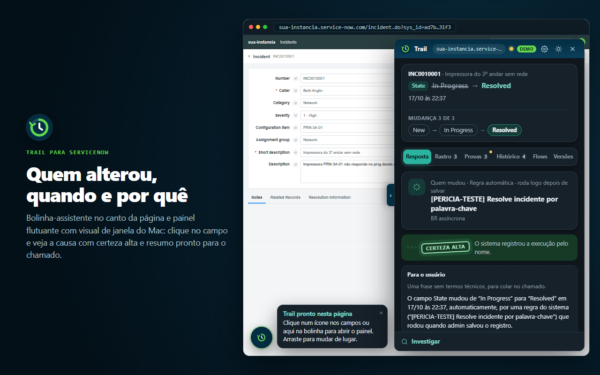
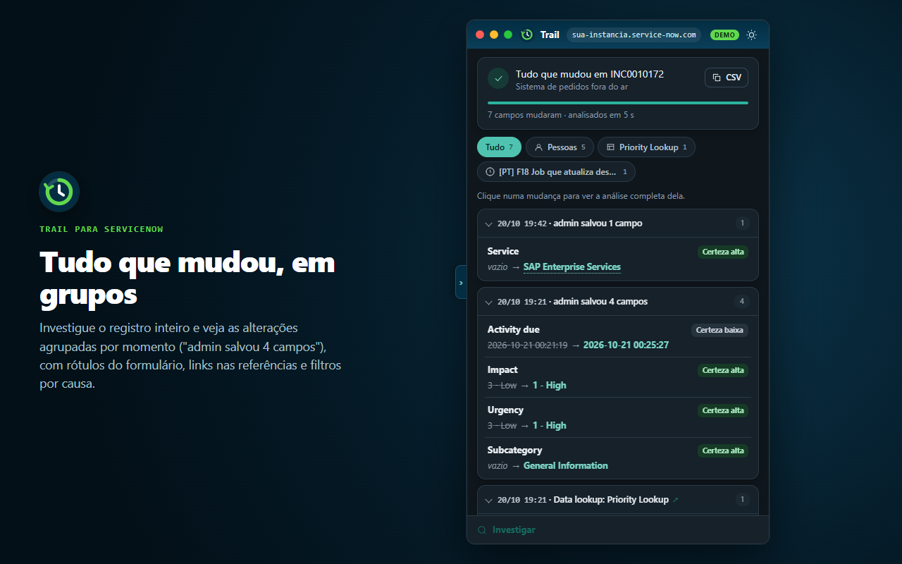
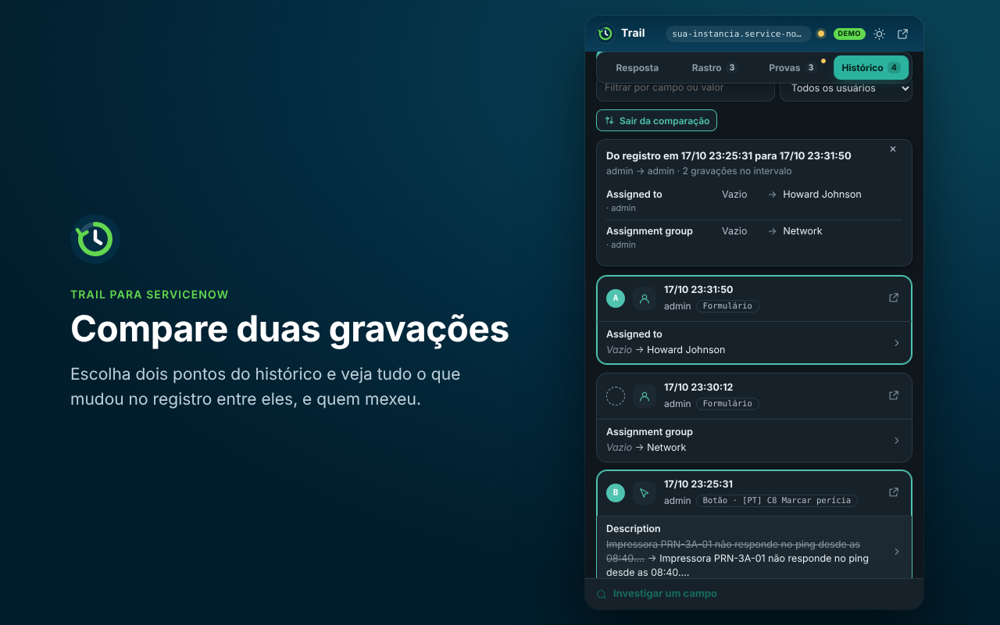

# Trail

**O que mudou este campo no ServiceNow, quando e por quê?**

O **Trail** é uma extensão MV3 para Microsoft Edge e Google Chrome que investiga alterações em registros do ServiceNow e responde, em linguagem simples e com provas verificáveis, quem ou qual automação mudou um campo, em que momento e com qual grau de certeza.

- **Somente leitura:** a extensão nunca grava, altera ou apaga nada na instância. Ela faz apenas consultas `GET` na Table API usando a sessão já autenticada do navegador e o token `X-UserToken`.
- **Sem telemetria nem servidor próprio:** tudo roda localmente no navegador. Nenhum dado da instância sai da sua máquina.
- **Permissão por instância:** nenhuma permissão de host é exigida na instalação; você escolhe em qual instância conectar.



---

## O que o Trail faz

Ao abrir um formulário ou lista no ServiceNow (UI16, Next Experience Workspace ou Service Portal), o Trail coloca um ícone discreto ao lado de cada campo e uma **bolinha-assistente** sempre à mão no canto da página:

1. **Bolinha-assistente e painel flutuante na página:** a bolinha fica no canto da instância conectada, pode ser arrastada para qualquer altura (encosta na borda mais próxima e lembra a posição), dá boas-vindas uma vez por registro e mostra a dica ao passar o mouse. Um clique na bolinha ou no ícone de um campo abre o painel flutuante com visual de janela do Mac: cantos arredondados, redimensionável por qualquer borda ou canto, bolinhas de fechar / minimizar / **sempre visível** (Document Picture-in-Picture que fica por cima de tudo, até de outros programas), setinha lateral, `Esc` e `X` que escondem o painel de volta na bolinha, e botão para enviar ao painel lateral do Edge ou abrir em janela separada.
2. **Resposta direta, nomes do formulário e grau de certeza:** cruza a auditoria (`sys_audit`) com os rastros de execução (`syslog_transaction`, `sysevent`, contextos de Flow Designer e Workflow, importações, contexto gravado) e com os metadados ativos da tabela (Business Rules `before`/`after`/`async`, Script Includes, Client Scripts, UI Policies, UI Actions, Data Lookups, regras de atribuição e Scheduled Jobs). Mostra o rótulo certo do campo por tabela (`sys_documentation`), o valor legível no lugar de `sys_id` (com links clicáveis em referências) e classifica cada causa com **Certeza alta**, **Certeza média** ou **Certeza baixa**, listando os fatos que somaram ou tiraram pontos.
3. **Rastro segundo a segundo:** mostra tudo que aconteceu no registro nos segundos em torno da mudança e quais outros campos foram gravados junto.
4. **"Tudo que mudou" em grupos por momento (registro inteiro e lote):** analisa todos os campos alterados num registro ou o mesmo campo em vários registros de uma lista (com exportação para CSV). Durante a leitura, usa a mesma animação da trilha que se desenha com a lupa (`Loading.tsx`) com etapas próprias (*"Lendo a auditoria do registro..."*, *"Separando os campos que mudaram..."*) e agrupa o resultado por gravação (*"admin salvou 4 campos"*), com filtros por pessoa, API ou automação.
5. **O que mudou entre dois momentos:** na linha do tempo do registro, permite escolher dois momentos quaisquer e ver apenas os campos que ficaram diferentes entre eles.
6. **"E se?" (simulação somente leitura):** prevê quais regras, client scripts e lookups reagiriam se o campo mudasse para outro valor antes de salvar, sem gravar nada.
7. **Mapa de automações, conflitos, resumo e PDF:** lista tudo que pode gravar no campo na ordem de execução do ServiceNow, alerta quando duas regras ativas disputam o mesmo campo com valores diferentes, gera uma frase sem jargão técnico pronta para colar no chamado e exporta relatório completo para PDF.





---

## Como instalar e usar no Edge ou Chrome

### A partir do pacote `.zip` ou da pasta compilada

1. Se recebeu o `.zip` da versão, extraia o conteúdo em uma pasta local. Se estiver com o código-fonte, rode `npm run build` e depois `bash tools/atualizar-extensao.sh` (que prepara a pasta fixa `../trail-extensao`, sem arquivos `.map`, e gera `../trail-edge-<versão>.zip`).
2. Abra `edge://extensions` (no Edge) ou `chrome://extensions` (no Chrome).
3. Ative a chave **Modo de desenvolvedor** (*Developer mode*).
4. Clique em **Carregar sem compactação** (*Load unpacked*) e selecione a pasta extraída (por exemplo `../trail-extensao` ou `extension/dist`).
5. Abra um registro na sua instância ServiceNow e clique no ícone do **Trail** na barra do navegador (ou no botão **Conectar nesta instância**): a extensão pede permissão apenas para aquela instância e já abre o painel flutuante na página.

### Atualização automática em modo sem compactação

Quando a extensão está carregada sem compactação a partir de `../trail-extensao` (ou `extension/dist`), você não precisa clicar em "Recarregar" em `edge://extensions` a cada mudança: basta rodar `npm run build && bash tools/atualizar-extensao.sh`. O service worker detecta o novo `build.txt` automaticamente, recarrega a extensão sozinho e reinjeta os scripts e a bolinha-assistente nas abas conectadas.

---

## Como compilar e testar

Pré-requisitos: Node.js 20+ e npm.

```bash
npm install
npx playwright install chromium

npm run typecheck                  # verificação de tipos (tsc -b)
npm test                           # 135 testes unitários (vitest: 133 do motor + 2 da extensão)
npm run build                      # compila o motor e a extensão em extension/dist
npm run e2e                        # 8 suítes e2e no Chromium (smoke, UI16, lista, portal, workspace, preferências/janela, painel flutuante e auto-reload)
bash tools/atualizar-extensao.sh   # atualiza ../trail-extensao (auto-reload) e gera ../trail-edge-<versão>.zip
```

### Modo demonstração (sem instância)

Depois de compilar, você pode abrir o painel em modo demonstração sem precisar de uma instância ServiceNow:

- `src/sidepanel/index.html?demo=1&float=1` — investigação de um campo no cabeçalho de janela flutuante (com troca entre um campo e o registro inteiro na gaveta **Investigar**)
- `src/sidepanel/index.html?demo=1&batch=1` — análise em lote de vários registros
- `src/sidepanel/index.html?demo=1&batch=rec` — análise do registro inteiro (`&wait=1` mostra a trilha animada com a lupa em andamento)
- `src/sidepanel/index.html?demo=1&tab=whatif` — aba **"E se?"**

---

## Estrutura do repositório

```text
packages/core/          motor de investigação em TypeScript puro (sem dependência de navegador)
  src/investigate.ts    pipeline: auditoria → rastros → metadados → assinaturas → pontuação
  src/signatures/       uma assinatura por mecanismo do ServiceNow (puras, sem chamadas de rede)
  src/scoring.ts        pesos dos fatos verificáveis e faixas de certeza
  src/preview.ts        simulador "E se eu mudar?" (somente leitura)
  src/batch.ts          análise em lote e do registro inteiro + agrupamento e exportação CSV
  src/timeline.ts       linha do tempo do registro e comparador entre dois momentos
  src/fieldMap.ts       mapa de automações que gravam no campo
  src/conflicts.ts      detecção de regras em conflito
  src/display.ts        resolução de rótulos (sys_documentation / sys_dictionary), choices e referências
  src/access.ts         detector de nível de acesso às tabelas de rastro
  src/client/           RestClient, FetchRestClient (sessão + X-UserToken) e FakeRestClient
  test/                 133 testes unitários do motor
extension/              extensão MV3 (Preact + Vite)
  public/manifest.json  permissões mínimas e optional_host_permissions por instância
  src/background/       service worker (executa o motor, vigia build.txt em dev e reinjeta abas conectadas)
  src/content/          ícones nos campos (UI16, Workspace, Portal, listas), bolinha-assistente, painel flutuante e diff
  src/page/             leitura de g_ck, idioma da sessão e contexto do formulário no mundo MAIN
  src/sidepanel/        interface do painel (App, Result, Batch, Timeline, WhatIf, FieldMap, Loading)
  src/options/          preferências de tema, idioma, onde abrir o painel e bolinha-assistente
  src/shared/           traduções (pt e en), estilos (ui.css), modo demonstração e mensagens
site/                   site de apresentação (site/b3) com demonstração interativa embutida
tools/                  script atualizar-extensao.sh (atualiza pasta descompactada e gera zip da versão)
tests/e2e/              8 suítes ponta a ponta com Playwright e a extensão carregada no Chromium
tests/regression/       bateria de regressão (441 casos) e casos de teste às cegas
docs/                   diário contínuo (DIARIO.md), passagem (PASSAGEM.md), loja (loja-edge.md), papel x_trail_reader e Fase 2
```

---

## English

**Trail** is a read-only MV3 browser extension for Microsoft Edge and Google Chrome that answers a single question for any field on a ServiceNow record: **what changed this field, when, and why?**

- **Strictly read-only & private:** Trail only issues `GET` requests to the ServiceNow Table API using your existing browser session and `X-UserToken`. It never writes to the instance, has no backend server, and collects no telemetry.
- **Assistant bubble & Mac-style floating panel:** a draggable assistant bubble stays in the corner of connected pages (greeting once per record and showing a tip balloon on hover). Clicking a field icon or the bubble opens a Mac-style floating panel right inside the page — resizable from any edge, with close / minimize / **always on top** (Document Picture-in-Picture) buttons, `Esc` and `X` to fold back into the bubble, and a button to dock into the Edge side panel.
- **Evidence-based forensics & full toolkit:** cross-checks `sys_audit` with execution traces and active metadata, displaying table-specific field labels (`sys_documentation`), clickable reference links, verifiable facts, and **High / Medium / Low certainty**. Includes a second-by-second trace, **"Everything that changed"** grouped by save (*"admin saved 4 fields"*) with an animated trail-and-magnifying-glass loader, a **"What changed between two moments"** timeline comparator, a read-only **"What if?"** simulator, a rule-conflict map, and plain-language ticket summaries. Full UI in **Portuguese** and **English**.

### Build, test, and load unpacked

```bash
npm install
npx playwright install chromium
npm run typecheck && npm test && npm run build && npm run e2e
bash tools/atualizar-extensao.sh
```

Load `../trail-extensao` (or `extension/dist`) via **Load unpacked** in `edge://extensions` or `chrome://extensions`. When loaded unpacked, running `npm run build && bash tools/atualizar-extensao.sh` automatically reloads the extension and re-injects connected ServiceNow tabs.

---

## Licença / License

[MIT](LICENSE).
